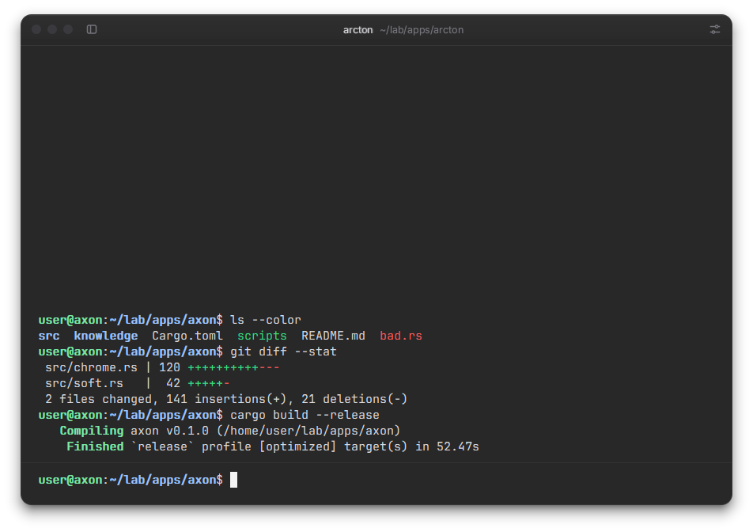
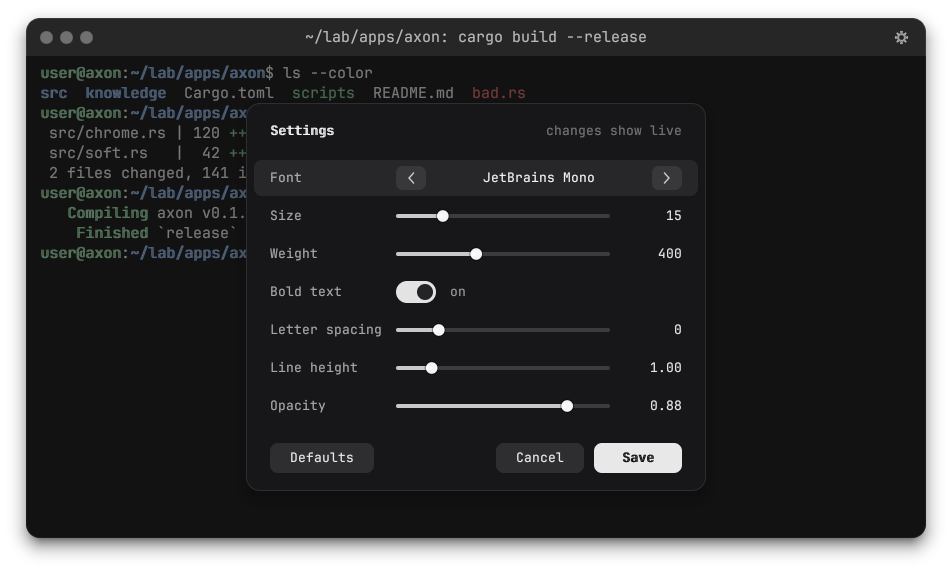

# axon

Native terminal emulator: **simple, minimalist, high-performance and futuristic**.
Written in Rust, for **Linux** (Wayland: own client, CPU-rendered into `wl_shm`, no GPU stack; a `winit` + `wgpu` fallback for X11 until it gets its own client, see `knowledge/decisions/core/0011-software-render-wl-shm.md`) and **Windows** (own Win32 window, the same CPU renderer, `knowledge/decisions/core/0039-windows-port.md`).

**Website:** <https://iv44n.github.io/axon/> · **Install:** Linux `curl -fsSL https://iv44n.github.io/axon/install.sh | sh`, Windows `irm https://iv44n.github.io/axon/install.ps1 | iex` (see [Installation](#installation))



<sub>A frame from the real renderer (`scripts/design.sh`), with alpha: what you see behind it is this page.</sub>

- **Own window layer and CPU renderer**: the grid is painted straight into a shared-memory buffer (a Wayland client on Linux) or a layered Win32 window (on Windows), only the damaged rows. ~18 MB idle on Linux, no Vulkan or GL loaded.
- **Zero idle usage**: no continuous redraw; it only paints when there are events (the one timer is the time chip's clock, once a minute, and only while that chip is shown).
- **Full VT emulation** thanks to [`alacritty_terminal`](https://crates.io/crates/alacritty_terminal).
- **Dark glass look** (after the `terminal.html` reference, ADR 0021, 0036 and 0037): one rounded translucent pane with a soft shadow; a title bar divided from the grid by a hairline, the line you type at docked at the bottom below another (output rises above it; it is still your shell's own prompt and line editor), grey window buttons that turn red/yellow/green on hover, one amber accent and six clear hues (also the ANSI colours), a proportional UI font (Geist, else Inter) around the monospaced grid, the reference's airy margins, quiet outline-icon chips and a settings panel docked beside the terminal; the status bar is there if you ask for it (`[window] status_bar`). The frame is computed per pixel (`src/chrome.rs`), no images. On the default backend; the `winit` fallback only has the black-and-white colours.
- **Windows, groups and panes**: one shell per window, listed in a panel at the left or right or as tabs in the title bar; windows can be put in coloured groups (a dialog with templates that open real windows with their commands typed in), renamed in place, reordered and regrouped by dragging, and closed with an *Undo*; each row says what its shell is doing (the prompt, a turning ring while a command runs, a red dot when the last one failed, and the mark of Claude, Codex or Antigravity when one runs there: faint while Claude works, with an amber dot while it waits for you). **A group is a split view**, as a tab with split panes is in Warp: the windows of the group you are in are shown side by side (columns, rows or a grid), and `Ctrl+Space` on a window in no group makes the group; drag the gap between two of them (or `Alt+Shift+arrows`) to make one bigger or smaller. Right click opens the menu of whatever is under the pointer. See [Shortcuts](#shortcuts).
- **Command palette and overview**: `Ctrl+K` lists actions, windows and groups (ranked as you type, each with its shortcut); `Alt+O` shows every window as a card with the last rows of its terminal, in a section per group, with a filter and drag and drop between groups.
- **SSH servers by alias** (ADR 0048): `Alt+H` (or the server button in the title bar) opens a panel beside the terminal with your servers, the last used first, each with a green light while a window has a session to it. Paste a long `ssh -i key.pem user@host -p 2222` and it becomes an alias; the servers are written to `~/.config/axon/ssh_config`, which axon includes from the top of `~/.ssh/config` the first time (one line; nothing else there is touched), so `ssh web` works in any shell, inside axon or not. A click connects where it makes sense (the window already in that session, the pane at an empty prompt, or a new window in the group *Servers*); import your `~/.ssh/config`, export or copy axon's file. A window in an ssh session is named after the server and shows a cyan dot.
- **Prompt chips** (opt-in): a row of context chips on the line above your prompt (time, user, directory, git branch and changes, conda/venv, pyenv, Kubernetes), chosen and ordered by you. See [Prompt chips](#prompt-chips).
- **Design board**: `design/board.html` shows frames of every screen (the window, the settings panel, the panel of servers, the panes, the palette, the overview, the group dialog and menus, in English and Spanish) from the real renderer over different desktops, zoomed to the pixel and compared with a baseline (see [Design](#design)).
- **Small binary** (8.2 MiB on Linux, see [Benchmarks](#benchmarks)) with LTO, `panic=abort` and `strip`.

## Requirements

- Windows 10 (version 1809) or 11, 64-bit: nothing else to install (on ARM the x64 build runs emulated). The shell is PowerShell 7 (`pwsh`) when it is installed, else Windows PowerShell, else `cmd`; `AXON_SHELL` names another. Fonts: JetBrains Mono, Cascadia Mono or Consolas.
- Linux on x86_64 or aarch64. The released binaries are linked on Ubuntu 22.04 and need glibc 2.35 or newer (Ubuntu 22.04,
  Debian 12, Fedora 36 and later); elsewhere, or on musl, build from source with a recent stable Rust (`cargo`, 2024 edition).
- On Wayland: `libxkbcommon.so.0` (loaded at run time for keyboard layouts; every desktop with Wayland has it). On X11, or without that library, axon falls back to `winit` + `wgpu`, which needs a Vulkan/GL driver.
- A monospaced font. By default it looks for, in this order: `~/.local/share/fonts/JetBrainsMono[wght].ttf`,
  `CascadiaMonoNF.ttf`, `CascadiaMono.ttf` and DejaVu Sans Mono. JetBrains Mono has no Nerd/Powerline icons: set
  `AXON_FONT` to a Nerd Font if your prompt uses them.

## Installation

**Windows** (PowerShell; no administrator needed): downloads `axon-x86_64-windows.zip` from the GitHub release, checks its SHA-256 and
installs for your user under `%LOCALAPPDATA%\Programs\axon`, with the folder on your `PATH`, a Start menu shortcut and an entry in
Settings › Apps (ADR 0040).

```powershell
irm https://iv44n.github.io/axon/install.ps1 | iex
& ([scriptblock]::Create((irm https://iv44n.github.io/axon/install.ps1))) -Version v0.1.0   # a given release
& ([scriptblock]::Create((irm https://iv44n.github.io/axon/install.ps1))) -Uninstall        # remove it again
```

The installer is [`scripts/get.ps1`](scripts/get.ps1) (`AXON_VERSION` and `AXON_PREFIX` do what `-Version` and `-Prefix` do); from
the release zip, `powershell -ExecutionPolicy Bypass -File axon-x86_64-windows\install.ps1`; from a checkout,
`cargo build --release` and then `powershell -ExecutionPolicy Bypass -File scripts\install.ps1`.

**Linux, a released binary** (no Rust needed): the installer downloads `axon-<arch>-linux.tar.gz` from the GitHub release, checks its
SHA-256 and runs the `install.sh` inside it, which puts the same files as a source install under the prefix.

```sh
curl -fsSL https://iv44n.github.io/axon/install.sh | sh                            # the latest release, under ~/.local
curl -fsSL https://iv44n.github.io/axon/install.sh | sh -s -- --prefix /usr/local  # for everyone (it runs the install with sudo)
curl -fsSL https://iv44n.github.io/axon/install.sh | sh -s -- --version v0.1.0     # a given release
curl -fsSL https://iv44n.github.io/axon/install.sh | sh -s -- --uninstall          # remove it again
```

The installer is [`scripts/get.sh`](scripts/get.sh), served by the website as `install.sh`; `AXON_VERSION` and `AXON_PREFIX` do
what the options do. A bundle also installs by hand, from the [releases page](https://github.com/Iv44n/axon/releases):
`tar xzf axon-x86_64-linux.tar.gz && axon-x86_64-linux/install.sh`.

**Linux, from source:**

```sh
scripts/install.sh                       # build and install for your user under ~/.local
scripts/install.sh --prefix /usr/local   # system-wide (run as root with --no-build after building as yourself)
scripts/install.sh --uninstall           # remove it again
```

It installs the binary (`bin/axon`), a desktop entry (so axon appears in your launcher) and the icon
(`assets/axon.svg`) under the prefix, and warns if the prefix is not in your `PATH` or no monospaced font is found.
`--no-build` reuses `target/release/axon`; `DESTDIR` is honoured for packaging.

## Usage

```sh
cargo run --release      # run
cargo build --release    # binary at target/release/axon
```

Always use `--release`: debug mode is much slower.

### Shortcuts

| Shortcut | Action |
|---|---|
| `Ctrl+K` | The command palette: type to filter windows, groups and actions (each with its shortcut), `Up` / `Down` move, `Enter` runs, `Esc` or `Ctrl+K` closes; it changes the windows' panel position too (`[windows] tabs`) |
| `Ctrl+,` | Open or close the settings panel docked beside the terminal (also the sliders icon in the title bar); `Esc` closes it when it has the keyboard |
| `Alt+N` / `Alt+W` | New window (a shell of its own) / close the window: the toast says so with an *Undo* button, and the shell stays alive until it is gone |
| `Alt+1…9`, `Alt+[` / `Alt+]` | Go to window *n* / the previous / the next one |
| `Alt+G` / `Alt+Shift+G` | Open the new-group dialog (name, colour, the windows to group, templates that open new windows; the window on screen is ticked when it is in no group; the panel's second header button, or the new-group button left of the gear when the windows are tabs, does the same) / take the window on screen out of its group |
| Right click on the panel or tabs | Menu of what is under the pointer: a window (rename, duplicate, split, groups, close, close the others), a group's header (edit, fold, new window, dissolve, close), or the empty part (new window, new group) |
| Double click on a window's row or tab / `F2` over it | Rename it in place: `Enter` keeps the name, `Esc` cancels, an empty name goes back to the automatic one. A double click on a group's header edits the group |
| `Ctrl+Space` | Split: one more terminal in the group of the window on screen, shown beside it (to the right first, then an automatic grid). A window in no group is put in a new group first. A split that would leave a pane under 20 columns x 5 rows is refused, and no group is made |
| `Alt+\` / `Alt+-` | The same split, with the group's windows in columns / in rows (mixing the two gives the grid) |
| `Alt+,` / `Alt+.` | Focus the previous / the next window of the group (a click on a pane focuses it too) |
| Drag the gap between two panes | Resize the split: the boundary follows the pointer (the gap lights up and the pointer becomes a resize arrow), the panes on either side keep at least 20 columns x 5 rows, and every shell is told its new size as the boundary crosses a cell. A double click on a gap gives that direction's windows the same size again. The sizes are kept with the group, between runs too |
| `Alt+Shift+→` / `Alt+Shift+←` | The window on screen a step (a twentieth of the split) wider / narrower in its split; the others give or take the room in proportion. Only in a split: elsewhere the keys go to the shell |
| `Alt+Shift+↑` / `Alt+Shift+↓` | The same, taller / shorter |
| `Alt+=` | Give the windows of the split the same size again |
| `Alt+Shift+W` | Close the focused pane, which is a window of the group (with the *Undo* toast; a shell that exits closes its window); the cross at a pane's corner and the cross of its row in the panel do the same |
| `Alt+O` | The overview of windows: every window as a card (the last rows of its terminal, status, name, directory) in a section per group; type to filter (name, directory, group or terminal text), arrows or `Tab` to move, `Enter` or a click to go to a window, `Alt+N` for a new one, `Esc` clears the filter and then closes it |
| Drag a card in the overview | Drop it on a group's section to put the window into the group (on the *No group* one to take it out), or on the dashed tile to make a group with it; `Esc` puts it back |
| Drag a row or a tab | Reorder windows: drop it before or after another (it takes that window's group), on a group's header or chip to put it into the group, on the empty part of the list to take it out of its group. Drag a group's header or chip to move the group. `Esc` cancels. A status icon says what the shell is doing: the prompt, a turning ring while a command runs, the mark of the agent when the command is `claude` (Claude's burst of rays), `codex` (ChatGPT's knot) or `agy` (Antigravity's arch), which do not end by themselves and so do not turn, a red dot when the last command failed (all need the shell's hook: `axon shell-init`; bash gets it from axon) |
| `Alt+H` | The panel of SSH servers (the server button left of the gear does the same; it takes the settings' place): type to filter (alias, initials, then address or user), `↑`/`↓` to choose, `Enter` or a click to connect, `Ctrl+Enter` or a row's first button in a new window, its pencil to edit; *+ Server* to add one (paste an ssh command, `Enter` saves it with the proposed name), *More* to import `~/.ssh/config`, export or copy axon's file; `Esc` clears the search and then closes it |
| `Alt+B` | Show or hide the panel of windows (`[windows] tabs = "left" \| "right" \| "top"`, `side`, `side_width`); the button right of the window buttons does the same |
| `Ctrl+Shift+C` / `Ctrl+Shift+V` | Copy / paste |
| `Ctrl+Shift+Q` | Quit |
| `Ctrl` + `+` / `-` / `0` | Increase / decrease / reset font size |
| `Shift+PageUp/PageDown/Home/End` | Navigate the scrollback |
| `Ctrl+Shift+R` | Reload `config.toml` (fonts, spacing, opacity, blur, status bar, language, cursor, prompt chips, the windows' panel) |
| Mouse wheel | Scroll (sends arrow keys on the alternate screen; wheel reports when the program asks for the mouse); over the tabs at the top it scrolls them, a group or a window at a time |
| Middle click on a window's row or tab | Close the window (with the *Undo* toast) |
| Mouse in vim, tmux, htop, less | Clicks, drags, motion and wheel go to the program; hold `Shift` to select text anyway (`wl` backend) |
| Click on the command being typed | Moves the shell's cursor to that cell (it presses the arrows for you, across the rows of a command that wrapped): click the second row of a long command to fix it there. Needs the shell at its prompt (the hook has spoken and no command runs); a click on a program's screen, on the output, or on a dim suggestion (zsh-autosuggestions, fish) does not move it (ADR 0043) |
| Click, double click, triple click | Selection: simple, word, line |
| Drag the title bar, double click it | Move the window, maximize / restore |
| Title bar buttons (left): close, minimize, maximize | Window controls (grey; they turn red, yellow and green under the pointer) |
| Drag from an edge or corner, or just outside it | Resize the window |
| `Alt` + drag | Move the window (`winit` fallback only, it has no title bar) |

### Settings panel

Click the **sliders icon** at the right end of the title bar, or press **`Ctrl+,`**. A panel opens at the edge of the window
and the terminal gets narrower to make room (every window is resized); nothing is modal, so the terminal and the title bar keep
working beside it. With the windows' panel at the left the settings are at the right; **with it at the right they go to the left**.
It has three tabs. **Font**: the font (a picker over the installed monospaced fonts), size, weight, bold text, letter spacing, line
height, window opacity and compositor blur. **Input**: the input type (shell prompt or prompt chips), the clock format, the cursor
shape (block, bar or underline), a switch per chip (see [Prompt chips](#prompt-chips)) and **Autosuggestions** (`[input] autosuggest`: read
and saved already, the editor that draws the suggestion comes later). **Windows**: where the list of windows lives (left, right or top),
whether its panel is visible, its width, and the interface **language** (auto, English or Español). Every change shows on the real
terminal beside the panel, so you judge the text by eye, and **is saved at once** to `~/.config/axon/config.toml` (your comments stay,
only what you changed is written; a slider writes when you let go, a key held down writes once). There is no Save and no Cancel:
**Reset to defaults** at the bottom puts every setting back. A failed write is written next to that button.

Keys (when the panel has the keyboard: it does when it opens or is clicked, and the terminal has it after you click there): arrows and
`Tab` move between rows (the ones that do nothing now are skipped), left and right change a value (`Shift`: five steps; on the chip
grid they move the cursor; radios wrap), `Space` or `Enter` flip the switch, pick the next radio or switch the chip, `Alt+Left` /
`Alt+Right` move a chip, `PageUp` / `PageDown` or `Ctrl+Tab` change tab, the wheel scrolls the page, `Esc` closes the panel. The
app's own shortcuts (`Alt+...`) keep working.

**Typing a number:** click the number at the right of a slider (or select its row and just start typing). It becomes a
box: type digits, a `.` or `,` for decimals and a leading `-`; `Enter`, `Tab`, or a click elsewhere keeps it, `Esc`
drops it. A typed number is not limited to the slider's span, only to the file's limits (size 6 to 96, weight 100
to 900, spacing -8 to 32, line height 0.8 to 3, opacity 0.3 to 1); weights snap to tens.



### Prompt chips

`[input] mode = "chips"` (or **Input type → Prompt chips** in the settings panel) draws a row of quiet chips (an outline icon
and coloured text, no box) on the line right above the prompt you are typing at, in the style of Warp's prompt chips. They sit exactly where you type, move
with the prompt, and disappear while a program runs. The shell still edits the line: axon does not replace your prompt,
it adds context above it. Like any prompt in axon it is docked at the bottom of the window, below a hairline, and while
nothing is typed it says *Type a command* after the cursor. **The chips replace your prompt's own text** (`user@host:~/dir`) with a bare `$`, since they say it already; your `PS1` is kept and comes back when you switch to *Shell prompt*, and the window title is still set. Chips are drawn at **84 % of the font size** set in the settings and 80 % opaque (a 14 px font gives 11.8 px chips; the icon and the spacing follow), with outline icons, from the same font file, rasterized on the fly through one reused buffer, so they keep no tiles or caches.


| Chip | Shows | Comes from |
|---|---|---|
| `time` | `03:48 pm` (or `15:48`, `clock = "24h"`) | the clock; the only wake-up while idle, once a minute |
| `user`, `host` | `alice`, `alice@machine` | `$USER`, `/proc/sys/kernel/hostname` |
| `dir` | `~/Desktop` (the last three parts if longer) | `/proc/<shell>/cwd`: right with no help from the shell |
| `branch` | `main`, or a short hash when detached | `.git/HEAD`, worktrees and submodules included |
| `changes` | `3 • +10 -2`: files, lines added, lines removed | `git diff HEAD --numstat`, run by the shell's hook at each prompt (with the repository's own hooks and filters off, under `timeout 0.5`), so it needs the hook (`axon shell-init`; bash gets it from axon) |
| `pyenv` | `3.12.1` | `$PYENV_VERSION`, else the nearest `.python-version`, else `~/.pyenv/version` |
| `kube` | `prod-eu` | `current-context` of `$KUBECONFIG` or `~/.kube/config` |
| `env` | the conda environment or virtualenv | the shell's own variables, through the hook below |

A chip with nothing to say is skipped. **Order:** in the settings panel (Input tab) drag a chip to a new slot to reorder it, drag it into the greyed area to switch it off (and back to switch it on), or focus it and press `Alt+Left` / `Alt+Right`; a click still toggles it. The order is the `chips = [...]` list, so it is saved with the file and survives page changes and context updates. The list decides which appear and in what order; chips that
do not fit the window width are shortened with `…` and then dropped from the end. They are re-read when the terminal
prints (at most twice a second), never on the UI thread.

**How axon finds your prompt.** axon cannot see where the shell draws its prompt, so the shell marks it: while the chips
are on, the prompt starts with a line of its own holding one concealed space (whose colour is the prompt's number) and
ends with another where you type. axon finds those marks, in the scrollback too: the prompt you are typing at gets the
chips, and the line of a prompt whose command has run is left blank, a gap between one command and the next. The marks are invisible, count as one column and copy as
spaces. **axon starts bash with the
hook already in `PROMPT_COMMAND`**, so it works with nothing to configure and switches on and off at the next prompt
without a restart. For zsh, fish, or a bash whose rc file replaces `PROMPT_COMMAND`, add one line to the rc file:

```sh
eval "$(axon shell-init bash)"          # ~/.bashrc;  zsh: ~/.zshrc;  fish: axon shell-init fish | source
```

**How long each command took.** At the right end of a command's line, once it has finished, axon shows a green check
or a red cross with the exit status (when it is not 0) and the time: `12ms`, `1.4s`, `2m 5s`; always when it failed, else
while the pointer is over its output. The hook tells axon when a
command starts and when the next prompt appears, through window-title escapes that axon swallows (they never reach your
title bar), and axon times them as it reads them. The last 256 prompts are remembered; older rows keep an empty line.
The hook also tells axon your conda/venv, `PYENV_VERSION` and `KUBECONFIG` (only the shell knows them). A prompt
framework that rewrites `PS1` on every prompt (starship, oh-my-posh) may need the hook after it. The chips are on the `wl`
backend only. The terminal beside the settings panel is the preview.

### Language

The window's text (settings panel, status bar hints) is available in **English and Spanish**. `[ui] language`
is `auto` (the default: Spanish when `LC_ALL`, `LC_MESSAGES` or `LANG` starts with `es`, English otherwise), `en` or `es`;
the Language row of the settings panel's Windows page changes it live. The config file, the command line and the shell hooks stay
in English. Strings live in `src/i18n.rs` (ADR 0022).

### Configuration file

The settings panel writes the file for you as you change things; it can also be edited by hand. axon reads `~/.config/axon/config.toml`
(or `$XDG_CONFIG_HOME/axon/config.toml`) if it exists; every setting is optional. **Create it from the terminal with `axon config`**: it writes the file with every setting, commented, and never
overwrites an existing one.

| Command | Does |
|---|---|
| `axon config` | Creates the file if it is missing and prints where it is |
| `axon config edit` | The same, then opens it in `$VISUAL` or `$EDITOR` |
| `axon config show` | Prints the settings in effect (file plus environment) and the mistakes in the file |
| `axon config path` | Prints the path |
| `axon shell-init bash\|zsh\|fish` | Prints what to add to the shell's rc file so the prompt chips work in it |
| `axon --help`, `axon --version` | Usage, version |
 [`assets/config.example`](assets/config.example) lists them all, commented, and `scripts/install.sh` puts a
copy in `share/doc/axon/`. **`Ctrl+Shift+R` applies the file to the running window.** A mistake is printed to stderr
with its line number and skipped; a number out of range is clamped.

```toml
[font]
family = "JetBrains Mono"   # a family name, or the path of a .ttf / .otf
size = 15                   # pixels, 6 to 96
weight = 400                # 100 thin ... 900 black (synthesized for now)
bold = true                 # bold text at weight + 300; false draws it regular
letter_spacing = 0          # extra pixels between letters, -8 to 32
line_height = 1.0           # multiple of the font's own height, 0.8 to 3
smoothing = "rgb"           # "rgb" or "bgr" (LCD sub-pixels, match your panel) or "gray"
hinting = true              # snap flat tops, x-height and baseline to whole pixel rows

[window]
opacity = 0.88              # 0.3 to 1
blur = false                # ask the compositor to blur behind the glass (KDE, ext-background-effect; not GNOME)
status_bar = false          # the 28 px bar at the bottom: shell, encoding, branch, key hints, grid size

[ui]
language = "auto"           # "auto" (your locale), "en" or "es": the language of the window's text

[input]
mode = "shell"              # "shell" leaves the prompt as it is; "chips" puts the chips above it
clock = "12h"               # "12h" (03:48 pm) or "24h"
cursor = "block"            # "block", "bar" or "underline" until a program asks for another (it does not blink)
autosuggest = true          # suggest the rest of a command while typing (read and saved; the editor that shows it comes later)
chips = ["time", "user", "env", "pyenv", "host", "dir", "branch", "changes", "kube"]   # shown left to right

[windows]
tabs = "left"               # where the list of windows lives: "left" or "right" (a panel), or "top" (tabs in the title bar)
side = true                 # whether the panel is shown (Alt+B toggles it)
side_width = 220            # the panel's width in pixels, 160 to 320
scope = true                # every window's shell in a systemd scope of its own: what runs from a window is counted (and killed under memory pressure) apart from the others
restore = true              # open again where the last run left off: the windows, each in its folder, with their names and groups
```

The file is a small subset of TOML read by our own parser (`src/config.rs`): sections, `key = value`, `#` comments,
strings, numbers and booleans. The Weight is synthesized because the font reader (`fontdue`) cannot read the variable
axis of a font like `JetBrainsMono[wght].ttf`; the own font reader (task 12) will use the real axis.

### Environment variables (win over the file)

| Variable | Default | Description |
|---|---|---|
| `AXON_FONT` | — | Path to a monospaced `.ttf`/`.otf` font |
| `AXON_FONT_SIZE` | `15` | Font size in logical pixels |
| `AXON_OPACITY` | `0.93` (`winit`), `0.88` (`wl`) | Opacity of the glass body (if the compositor supports transparency) |
| `AXON_DECORATIONS` | off | `1` to use the system title bar (`winit` fallback only) |
| `AXON_BACKEND` | `wl` on Wayland, else `winit` | `wl`: own Wayland client + CPU renderer (~18 MB idle). `winit`: `winit` + `wgpu` (~150 MB idle), also the automatic fallback if `wl` cannot start |
| `AXON_SETTINGS` | — | A debugging aid: start with the settings panel open (screenshots, measurements) |
| `AXON_HOSTS` | — | A debugging aid: start with the panel of SSH servers open, on `list`, `new`, `edit` (the first server), `import` or `export`, over your own servers |
| `AXON_WINDOWS` | `1` | A debugging aid: start with *n* windows (up to 9) |
| `AXON_PANES` | `1` | A debugging aid: start with *n* terminals split in a group around the first window (up to 12) |
| `AXON_GROUPS` | — | A debugging aid: set (any value) with `AXON_WINDOWS` of 2 or more, the first two windows start in one group |
| `AXON_SESSION` | the state directory's `axon/session` | Where the windows are kept between runs (`[windows] restore`): a file, or `off` to neither read nor write it for this run (what `scripts/bench.sh` does). A run with a debugging aid does not touch it either |
| `AXON_RUNNING` | — | A debugging aid: every window counts as running a command (the turning ring, the folded groups' dots) |
| `AXON_OVERVIEW` | — | A debugging aid: start with the overview of windows open |
| `AXON_LIST_UI` | — | A debugging aid: start with one of the window list's screens open: `dialog`, `edit`, `menu`, `group-menu`, `strip-menu`, `rename`, `close` or `toast` (`edit` and `group-menu` need `AXON_GROUPS`) |
| `AXON_DEMO_OVERLAY` | — | A debugging aid: start with one of the overlay kit's screens open (`field`, `list`, `menu`, `toast`, `modal`), or `palette` for the real command palette |
| `AXON_WL_DEBUG` | — | A debugging aid: trace the Wayland protocol on stderr |
| `AXON_SHELL` | — | Windows only: the shell to start (a path or a name on the `PATH`), instead of `pwsh`, `powershell` or `cmd` |
| `AXON_SELFTEST` | — | A debugging aid, for CI: a folder; axon runs a real shell, types a command, changes directory, round-trips the clipboard, maximizes and restores, idles 3 s, writes `selftest.txt` and `frame.argb` (the window's pixels; `scripts/argb2png.py` makes a PNG) there and exits 0 or 1. `scripts/selftest.ps1` runs it on Windows; `.github/workflows/windows.yml` does on every push |

## Design

The look is designed on real frames, not mockups. `src/design.rs` renders the window through the actual
renderer in a fixed set of scenes (states, palette, opacity variants) and writes PNGs with alpha plus the design
tokens; [`design/board.html`](design/board.html) puts them over several desktops (light, dark, a page of text,
stripes, checker), zooms to device pixels (1×, 2×, 4×) and compares against a baseline, side by side or split.

```sh
scripts/design.sh --baseline   # keep the current frames as the baseline
# ... change chrome.rs, palette.rs, soft.rs ...
scripts/design.sh              # render the new frames, then open design/board.html
```

The frames are build output (`design/frames/`, `design/baseline/`, git-ignored). `assets/screenshot.png` is a copy of
`design/frames/rest.png`, `assets/input-bar.png` of `design/frames/chips-hover.png`.

## Releases and website

A tag `vX.Y.Z` equal to `Cargo.toml`'s version publishes a release (`.github/workflows/release.yml`, ADR 0035): it builds on
Ubuntu 22.04 for x86_64 and aarch64, packs each with [`scripts/package.sh`](scripts/package.sh) (the binary, the icon,
`config.example` and `install.sh`, as `axon-<arch>-linux.tar.gz` plus its `.sha256`; no version in the name, so
`releases/latest/download/` always finds the newest) and attaches them to the GitHub release. The same tag builds `axon-x86_64-windows.zip` on `windows-latest`
([`scripts/package.ps1`](scripts/package.ps1): `axon.exe`, the icon, `config.example` and `install.ps1`; ADR 0040), after the exe passed its own
self-test (`AXON_SELFTEST`, below), and attaches it too.

```sh
# bump version in Cargo.toml, commit, then
git tag v0.1.0 && git push origin v0.1.0
```

The website is [`site/`](site/index.html): one static page, no framework and no request to other hosts. Its pictures are frames
of the real renderer in `site/shots/`. [`scripts/site.sh`](scripts/site.sh) builds it into `target/site/` with the icon and
`scripts/get.sh` as `install.sh` and `scripts/get.ps1` as `install.ps1` (`--serve` serves it on <http://localhost:8000>, `--shots` copies fresh frames from
`design/frames/`); `.github/workflows/pages.yml` publishes it on GitHub Pages at every push to `main` that touches it
(Settings → Pages → Source: *GitHub Actions*).

The page is in English and Spanish: the English text is the markup, the Spanish a dictionary at the end of `site/index.html`, keyed by
`data-i18n*` attributes. The language is the `?lang=en|es` of the URL, else the visitor's last pick (the EN/ES switch in the header),
else the browser's. A new string needs its `data-i18n` key and a Spanish entry.

## Benchmarks

Measured with [`scripts/bench.sh`](scripts/bench.sh) (`--clean` adds a cold build). Release profile: fat LTO,
`codegen-units = 1`, `panic = abort`, `strip`. Window 1000x640, idle shell. **Updated on every change that
can move size or speed** (rule in `CLAUDE.md`); older numbers stay in the history table.

Machine: AMD Ryzen 5 5600H (12 threads) + RTX 3050 Mobile, Ubuntu, kernel 7.0.0-44, GNOME Shell 50.1 on Wayland.
Last measured: 2026-11-27, `7bd7092` (v0.4.0) plus no `unsafe` (ADR 0049: `unsafe_code = "deny"` for the crate, allowed only in `xkb.rs`, `win.rs` and the pixels' mapping in `wl.rs`; an own reader of the time zone files, `tz.rs`, for the clock chip; the keymap read with `pread`; `malloc_trim` gone). +6.3 KB, 8,590,400 to 8,596,704 B, both built here (`tz.rs` most of it), no new dependency; idle and memory as before, 0 ticks; the flood 1.53 s at load 1.2-1.6, and an A/B against `7bd7092`, five floods of each in turn, 1.526 against 1.539 s on average (noise; axon's CPU 172 against 174 ticks, 40 MB after both); the design board's 163 frames byte-identical; `malloc_trim` gave back 0.2 MB after a toast (8.34 against 8.56 MB anon) and nothing at idle. Before it, 2026-11-27, v0.4.0: `9b12d7e` plus the panel of SSH servers (ADR 0048: `ssh.rs`, `hosts.rs`, `wlapp/hosts_ui.rs`, the servers' button in the title bar, a window's ssh session from the hook's command line). +195.7 KB, 8,394,712 to 8,590,384 B, both built here with rustc 1.96.0 (the panel 80.7 KB of code, the settings panel being 86.6; `ssh.rs` 30.6; the app's side 26.9; `core`'s generics, the strings in two languages and the unwind tables the rest), no new dependency; idle and memory as before, 0 ticks (`bench.sh` printed 19 MB for `wl` under load, three runs on a quiet machine gave 18.1-18.3 MB); the panel open 22.6 MB, as the settings, 0 ticks in 5 s; the flood 1.51 s at load 1.5-2.6 (another session of work ran on the machine), nothing of this change is on the PTY or paint path while the panel is closed. Before it, 2026-11-26, v0.3.0: `b10df3d` plus a split that can be resized (ADR 0045: `panes::Tracks`, the gaps' hit test and drag, `Alt+Shift+arrows`, the sizes in the session file) and the agents' own marks, which say whether Claude works or waits, with the title's status mark cut (ADR 0046: the marks' outlines and their scanline fill in `icons.rs`, their colours in `palette.rs`, `agent::State`, `status_mark` in `wlapp.rs`). +28.2 KB, 8,366,520 to 8,394,712 B (the split +19.3 KB and the marks +5.0 KB on their own branches, the waiting state and the merge the rest), no new dependency; idle and memory as before, 0 ticks (`winit` with Cascadia once 1 tick in 3 s: its path is untouched); the flood 1.49 s at load 1.1-1.2, where the branches' own runs gave 1.70 s (another build on five cores) and 1.53 s, and neither change is on the PTY path or a row's paint; a group of four windows shown split 21.3 MB, as before; a window whose program turns its title's mark the way Claude Code does while it works, `◐`/`◑` every 0.96 s, costs 0-1 ticks in 10 s, 1-4 before, five runs of each build in turn: the title without its mark does not change, so nothing is painted unless Claude's state does. Before it, 2026-11-26, at `5ed8214` plus the kept session, the click that moves the shell's cursor and the agents' marks (ADR 0042-0044: `restore.rs`, `caret.rs`, `agent.rs`, `wlapp/keep.rs`, the marks in `icons.rs`; +24.3 KB over it, 8,342,256 to 8,366,520 B, no new dependency; idle and memory as before; the flood 1.52 s at load 1.2-1.5, not run against `5ed8214` side by side, and nothing of this change is on the PTY or paint path; a window that runs `claude`, `codex` or `agy` costs no timer: 0 ticks in 5 s, where the same window running `cargo` turns its ring, 2 ticks on this build and 10 before ADR 0041's cheaper painting). Before it, 2026-11-26, at `18ff573` plus the change that paints the rows outside the terminal's lock (ADR 0041: the UI thread held it 2.3 ms a frame during a flood, painting, and now 0.08 ms, reading the cells), paints a grid row's glass as a fill and skips a glyph's empty pixels; +3.7 KB; the flood is 13 % faster in an A/B (notes under the throughput table), idle and memory as before. The machine was busier than on 2026-11-25 (load average 1-4 after the builds), so the absolute flood times moved for both builds. The table of windows, groups and screens and the older notes under the tables come from earlier builds (ADR 0036-0039) and were not measured again: nothing in this change touches them. **Windows** has its own line below: it is measured by the self-test on a GitHub Actions runner, not on this machine.

**Build**

| Binary | Cold release build |
|---|---|
| 8.2 MiB (8,596,704 bytes) | 101 s (before ADR 0036) |

**Idle memory and CPU** (`AXON_BACKEND` selects the backend; `wl` is the own Wayland client with the CPU renderer and the
default on Wayland, `winit` is the `winit` + `wgpu` fallback)

| Backend | Font | RSS | PSS | Private (anon) | CPU |
|---|---|---|---|---|---|
| `wl` | JetBrains Mono (default) | **18 MB** | 14 MB | 8 MB | 0 ticks / 3 s |
| `wl` | DejaVu Sans Mono | 24 MB | 19 MB | 14 MB | 0 ticks / 3 s |
| `wl` | Cascadia Mono NF | 60 MB | 55 MB | 50 MB | 0 ticks / 3 s |
| `winit` | JetBrains Mono (default) | 150 MB | 139 MB | 31 MB | 0 ticks / 3 s |
| `winit` | DejaVu Sans Mono | 155 MB | 145 MB | 37 MB | 0 ticks / 3 s |
| `winit` | Cascadia Mono NF | 191 MB | 181 MB | 74 MB | 0 ticks / 3 s |

The idle target is under 50 MB of RSS. `wl` meets it with the default font (the 4 MB over the 15 MB of before are the UI
font: 2.7 MB of its parsed outlines, narrowed to the characters an interface draws, and ~1.5 MB more of the binary's own code
paged in; opening the settings or an overlay no longer loads a font); a Nerd Font such as Cascadia Mono NF costs
~45 MB inside `fontdue` (it parses every glyph), which the own font reader will remove. The `winit` backend cannot meet
the target: the Vulkan loader and the drivers map ~94 MB. (`winit`'s PSS went from 56 to 96, 132 and now 72 MB with the RSS
unchanged: PSS divides shared pages among every process that maps them, so it follows what else runs on the desktop; on
2026-11-27 it was 95 MB, and 139 MB later that day.)

**Windows, groups and screens** (`wl`, default font, idle shell in every window; the debugging knobs `AXON_WINDOWS`,
`AXON_PANES`, `AXON_SETTINGS`, `AXON_HOSTS`, `AXON_OVERVIEW`)

| State | RSS | Private (anon) | CPU |
|---|---|---|---|
| One window | 18.6 MB | 8.4 MB | 0 ticks / 5 s |
| Three windows (grouped or not) | 21.1 MB | 10.6 MB | 0 ticks / 5 s |
| A group of four windows shown split (`AXON_PANES=4`) | 21.3 MB | 11.7 MB | 0 ticks / 5 s |
| Settings panel open | 22.8 MB | 11.8 MB | 0 ticks / 5 s |
| Panel of SSH servers open (`AXON_HOSTS=list`, 2026-11-27; the settings open measured 22.6 MB in the same run) | 22.6 MB | 12.0 MB | 0 ticks / 5 s |
| Overview of windows open (one window) | 19.1 MB | 8.4 MB | 0 ticks / 5 s |
| Three windows, each marked as running (the status spinners turn) | 21.3 MB | 10.6 MB | 11 ticks / 5 s |
| One window whose command is `cargo` (the hook's label: its ring turns) | - | - | 2 ticks / 5 s (10 before ADR 0041's cheaper painting) |
| One window whose command is `claude`, `codex` or `agy` (the agent's mark, still: ADR 0044) | - | - | 0 ticks / 5 s |
| One window whose program turns its title's mark (`◐`/`◑` every 0.96 s, as Claude Code while it works; the mark is cut, ADR 0046) | - | - | 0-1 ticks / 10 s (1-4 before) |

A shell killed with `SIGKILL` closes only its own window; when the last one goes, axon quits and removes its report files.

**Throughput** (`cat` of 99.6 MB of text lines)

| Backend | Time | RSS afterwards |
|---|---|---|
| `wl` | 1.53 s | 40 MB |
| `winit` | 1.28 s | 178 MB |

For ADR 0041 (painting outside the terminal's lock), nine floods of each build in turn, the build before it first: 1.91/1.60, 1.93/1.57, 1.90/1.67, 1.72/1.49, 1.99/1.58, 2.06/1.81, 2.29/2.12, 1.91/1.71 and 2.07/1.88 s, every pair faster, 1.98 against 1.71 s on average (-13 %); axon's own CPU during the flood fell 20 % (the UI thread from 49 to 17 ticks in one run). A first `scripts/bench.sh` run gave 1.82 s and 68 MB after: the window opened larger that time (~229 columns of scrollback); the second, in the tables, 1.76 s and 39 MB. The PTY thread is now not saturated (~58 % of a core): what is left is parsing and the kernel's PTY, which `winit` shares.


The 1.53 s and 1.28 s are no `unsafe` (ADR 0049) on 2026-11-27 at load 1.2-1.6: the keymap, the clock and the pixels' mapping are not on the PTY path, and the copy into a second buffer is the same `memcpy` as before (the A/B is in the note at the top). The 1.51 s and 1.36 s before them are the panel of SSH servers (ADR 0048) on 2026-11-27 at load 1.5-2.6, with another session of work on the machine; nothing of it is on the PTY path. The 1.49 s and 1.48 s before them are v0.3.0 (the resizable split and the agents' own marks, ADR 0045-0046), on 2026-11-26 at load 1.1-1.2; neither change is on the PTY path, and `winit`, whose code neither touches, moved from 1.28-1.41 s by the run. On their branches: 1.70 s with another build using five cores (ADR 0045) and 1.53 s at load 1.4-2.2 (ADR 0046). The 1.52 s and 1.28 s before them are the tree with ADR 0041's painting and the kept session, the click and the agents' marks (ADR 0042-0044) in, on 2026-11-26 at load 1.2-1.5, a quieter machine than the one of the A/B above: the two are not an A/B of each other, and none of the three later changes is on the PTY or paint path.

For ADR 0038 (a scope per window), four rounds with the scope on and off, in turn, at load 1.0-1.3: `wl` 2.39, 1.94, 1.89 and 1.93 s on against 1.78, 1.93, 1.78 and 2.07 s off (the first pair had a cold file cache; the rest average 1.92 against 1.93 s): the same within the noise, as it must be, since the scope changes where the shell is accounted and not what it does. The `scripts/bench.sh` run above, 2.01 s, is inside that spread. Startup to a window's first shell process, six launches in turn: 57, 59 and 59 ms without the scope, 65, 61 and 60 ms with it (the `systemd-run` that makes the scope runs in the shell's own process, and its probe overlaps the window's creation).

Before that, the machine was busy (load average 2.4-2.7): three runs each of this build and of the same tree drawing the rows
flat (no docked prompt), in turn, gave `wl` 1.87, 1.89 and 1.86 s against 1.87, 1.84 and 1.85 s, the same within the noise; a
`scripts/bench.sh` run just before, under load too, gave 2.10 s. For ADR 0036, three runs each of the build before it and
after it gave 1.81, 1.86 and 1.73 s against 1.78, 1.78 and 1.74 s (the RSS after it is 3 MB higher, the UI font). The spinners
of three running windows cost 10-11 ticks every 5 s in both builds of the A/B; the 3 ticks measured for ADR 0036 did not come
back in either. Before, idle machine, four runs of `scripts/bench.sh` in this stretch (`wl` 1.58, 1.57, 1.63 and 1.65 s, `winit` 1.33, 1.30, 1.38 and 1.35 s):
run-to-run noise is about 0.1 s, and the last two are within it of the first two. The 1.95-2.08 s of the title bar build was the machine (a browser held the load average at 3-4), not the code.

Not measured yet: startup time to the first frame, input latency, and a comparison with Alacritty, Ghostty and foot (not installed here).

**Windows** (the self-test on GitHub's `windows-latest` runner: a 4-core VM, 1024x768, pwsh 7; idle shell, window 972x640; `.github/workflows/windows.yml`,
ADR 0039; not this machine, and a VM's numbers move from run to run)

| What | Value |
|---|---|
| `axon.exe` | 1.8 MiB (1,880,576 bytes, v0.4.0, the same after ADR 0049; 1,690,112 at v0.3.0): no `wgpu` or `winit` in it |
| The release zip | 0.95 MB (`axon-x86_64-windows.zip`, v0.4.0) |
| Idle CPU | 0 ms in 3 s (the self-test fails above 150 ms) |
| Idle memory (working set, the process alone) | 30 MB (30.1 MB at v0.4.0, 30.0 after ADR 0049): Windows counts the pages of `user32`, `gdi32` and the other system libraries the window needs |
| The self-test (a command typed and its output read, a directory change, clipboard, maximize and restore) | passes in under 2 s of steps |

**History** (binary size and idle RSS with the default font; newest first)

| Date | Change | Binary | Idle RSS `winit` | Idle RSS `wl` |
|---|---|---|---|---|
| 2026-11-27 | No `unsafe` (ADR 0049): `unsafe_code = "deny"`, allowed only in `xkb.rs`, `win.rs` and the mapping of the window's pixels (now sealed against shrinking); the clock chip's time zone from an own reader of the zone files (`tz.rs`, checked against glibc in 487 zones); the keymap read with `pread`; Windows' `Wake` in std's `OwnedHandle`; `malloc_trim` removed (0.2 MB after a toast, 0 at idle); flood 1.53 s, A/B 1.526 against 1.539 s; no new dependency; Windows exe 1,880,576 B (the same), 30.0 MB idle, 0 CPU (CI runner) | 8,596,704 B (+6.3 KB) | 150 MB | 18 MB |
| 2026-11-27 | v0.4.0. The panel of SSH servers (ADR 0048): `Alt+H` and a title bar button, list with live status and when each was used, a pasted ssh command becomes an alias, import `~/.ssh/config`, export; servers in `~/.config/axon/ssh_config`, included from `~/.ssh/config`; a window in an ssh session is named after its server with a cyan dot; the palette lists `ssh <alias>`; no new dependency; panel open 22.6 MB, 0 ticks; flood 1.51 s; Windows exe 1,880,576 B (+190 KB), 30 MB idle, 0 CPU (CI runner) | 8,590,384 B (+195.7 KB) | 149 MB | 18 MB |
| 2026-11-26 | v0.3.0. A split resized by dragging its gaps or with `Alt+Shift+arrows`, `Alt+=` evens it, the sizes kept with the group (ADR 0045, `panes::Tracks`); the agents' own marks (ADR 0046): Claude's burst, Codex's cloud with `>_`, Antigravity's arch, filled in their colours (14 px in the list, 16 in the overview), faint while Claude works and with an amber dot while it waits for you, a program's status glyph cut from its title (Claude Code's `✳` drew the UI font's missing-glyph box); no new dependency; a group of four split 21.3 MB, 0 ticks idle; a title that turns its mark costs 0-1 ticks in 10 s, 1-4 before; flood 1.49 s | 8,394,712 B (+28.2 KB) | 149 MB | 18 MB |
| 2026-11-26 | The session kept between runs (ADR 0042, `[windows] restore`), a click on the typed line moves the shell's cursor (ADR 0043) and a window that runs `claude`, `codex` or `agy` shows the agent's mark, not a spinner (ADR 0044); no new dependency; the agent's window costs no timer (0 ticks in 5 s against 2 for a busy command); flood 1.52 s in `bench.sh` | 8,366,520 B (+24.3 KB over `5ed8214`) | 148 MB | 18 MB |
| 2026-11-26 | The rows painted outside the terminal's lock (ADR 0041), a grid row's glass as one fill (`chrome::flat_from`; it also fixes the lit panel button's bottom row), a glyph's empty pixels skipped, a configured font parsed once (it was twice: +88 ms of startup with a Nerd Font); flood 13 % faster in an A/B, 1.76 s in `bench.sh` | 8,342,256 B (+3.7 KB) | 148 MB | 18 MB |
| 2026-11-25 | The Windows port (ADR 0039): `plat.rs` seam, `win.rs`, PowerShell hook, `fallback.rs` split out of `main.rs`, the self-test; Linux numbers as before (flood 1.83 s, 0 ticks idle); Windows exe 1.6 MiB, 30 MB idle, 0 CPU (CI runner) | 8,338,544 B (+18.8 KB) | 150 MB | 18 MB |
| 2026-11-25 | Every window's shell in a systemd scope of its own (ADR 0038, `[windows] scope`): `systemd-run --user --scope` execs in place, a probe runs while the window is made, off where the user manager does not answer; +4.6 KB; flood and idle the same (A/B); 1-8 ms more to a window's first shell | 8,319,736 B | 151 MB | 19 MB |
| 2026-11-25 | The prompt docked at the bottom below a hairline (ADR 0037): `view::Fold` lays the lines on the rows, `Soft::band` draws them; +0.9 KB; flood and spinners the same as the rows drawn flat (A/B); one or two rows fewer for every program (the composer's gaps are kept) | 8,315,096 B | 151 MB | 19 MB |
| 2026-11-25 | The same as the reference, cleaner (ADR 0036): the UI font (Inter) for the title, the panel and the tabs, its character map narrowed to ~900 characters (`cmap.rs`: 2.7 MB parsed, not ~8.5); no status bar by default; quiet chips on the live prompt, a command's status at the end of its line; 22 px margins; +11.4 KB; settings open 22 MB (was 23), overview open 18.5 MB (was 20) | 8,314,200 B | 151 MB | 19 MB |
| 2026-11-25 | A group is the split (ADR 0034): a group's windows are shown side by side, `Ctrl+Space` makes the group; no new dependency, +8.2 KB over the row below; a group of four windows 18 MB | 8,302,768 B | 148 MB | 15 MB |
| 2026-11-25 | The second reference (`a44df93`): groups, split panes, overlay kit, docked settings, command palette, overview, group dialog, menus, rename, toasts, drag and drop, status icons, and the review fixes; +561 KB over the title bar row; three windows 17 MB, settings open 23 MB, overview open 20 MB | 8,294,576 B | 147 MB | 15 MB |
| 2026-11-24 | Title bar after the reference: panel button, name and place as the title, windows as tabs at the top (`tabs = "top"`) | 7,733,936 B | 149 MB | 15 MB |
| 2026-11-24 | Windows and the side panel (`Win` per shell, `side.rs`, `[windows]`, `Alt+N/W/1-9/[/]/B`, ADR 0023); one window idle 15 MB, three windows ~18 MB | 7,730,960 B | 150 MB | 15 MB |
| 2026-11-24 | The changes chip comes from the shell's hook (`git diff` with the repository's hooks and filters off, `timeout 0.5`), axon no longer runs git: `safe.directory` works, the 3 s timer and the git thread are gone | 7,694,984 B | 150 MB | 15 MB |
| 2026-11-24 | Interface in English and Spanish (`i18n.rs`, `[ui] language`, a Language row in the settings) | 7,694,728 B | 150 MB | 15 MB |
| 2026-11-24 | Per-command status (`history.rs`): the hook's title escapes timed on the PTY thread, a ring of 256 prompt records, chips kept on every prompt with a check or cross and the duration | 7,694,728 B | 148 MB | 15 MB |
| 2026-11-24 | UI after `terminal.html` (ADR 0021): new palette, hairlines, coloured window buttons, status bar, outline chip icons from the reference, settings with live preview, sliding tabs and cursor shape | 7,694,728 B | 145 MB | 14 MB |
| 2026-11-24 | Text quality: 6x supersampled glyphs with vertical hinting and LCD sub-pixel coverage (`font.rs`, `soft.rs`), settings in a proportional font with fades, draggable chip order; the settings screen open costs ~22 MB RSS | 7,617,368 B | 148 MB | 14 MB |
| 2026-11-24 | Prompt chips at 80 % of the font size (later 90 %, outline icons) (`Fonts::small`, `Soft::paint_text`): text rasterized on the fly, icons scaled | 7,585,040 B | 149 MB | 14 MB |
| 2026-11-24 | Window blur (`[window] blur`, settings switch): `ext-background-effect-v1` and KDE blur protocols in `wl.rs`; GNOME 50 offers neither | 7,586,856 B | 149 MB | 14 MB |
| 2026-11-24 | Prompt chips (`bar.rs`, `context.rs`, `paint.rs`): context chips on the line above the prompt, Input tab in the settings screen, `axon shell-init`; idle with the chips on 14.9 MB, flood 1.74 s with them | 7,583,032 B | 149 MB | 15 MB |
| 2026-11-24 | Watchdog: a redraw stuck on a lost frame callback or buffer release goes on after 250 ms (suspend and resume froze the window) | 7,498,904 B | 146 MB | 15 MB |
| 2026-11-23 | Settings screen: numbers can be typed into boxes | 7,499,608 B | 149 MB | 14 MB |
| 2026-11-23 | Settings screen (`settings.rs`, gear, sfnt reader, `config::save`); +5 MB RSS while it is open | 7,483,864 B | 150 MB | 14 MB |
| 2026-11-23 | Config file (`config.rs`): font family, size, weight, letter spacing, line height, opacity; `axon config` creates it, `Ctrl+Shift+R` reloads | 7,409,792 B | 150 MB | 14 MB |
| 2026-11-23 | Mouse reporting (`mouse.rs`: modes 1000/1002/1003, SGR, UTF-8, classic) | 7,370,048 B | 149 MB | 14 MB |
| 2026-11-23 | Continuous glass (no title pane, sheen or rim gradient), background-coloured cells are glass | 7,366,560 B | 149 MB | 13 MB |
| 2026-11-23 | Own window shadow (margin, window geometry, input region), opacity 0.88, design board | 7,366,064 B | 149 MB | 14 MB |
| 2026-11-23 | Sharper text (plain source-over, coverage contrast) and pixel-aligned buttons | 7,362,960 B | 155 MB | 14 MB |
| 2026-11-23 | Stage C: keyboard (`xkb.rs`), clipboard, wheel, selection; `wl` is the default backend | 7,363,488 B | 150 MB | 14 MB |
| 2026-11-23 | JetBrains Mono becomes the default font | 7,332,888 B | 149 MB | 13 MB |
| 2026-11-22 | `b30bc13`: glass chrome (`chrome.rs`), pointer input, black-and-white palette (Cascadia NF default) | 7,332,888 B | 196 MB | 55 MB |
| 2026-11-22 | `8db3cc9`: own Wayland client, `view.rs`, `session.rs` | 7,325,272 B | 191 MB | 54 MB |
| 2026-11-22 | `0b72197`: CPU renderer `soft.rs`, `cell.rs`, `font.rs` (not wired in) | 7,197,832 B | 191 MB | n/a |
| 2026-11-22 | `eae69b5`: initial commit (damage tracking, cell buffer, lazy fonts) | 7,197,400 B | 191 MB | n/a |
| 2026-11-22 | Before the lazy-font fix (never committed) | n/a | 946 MB | n/a |

## Architecture

```
src/
├─ main.rs      picks the backend; the `winit` + `wgpu` fallback app
├─ cell.rs      Cell format, flags, tile contract shared by the renderers
├─ font.rs      fonts, glyph table, special tiles (shared by the renderers)
├─ gpu.rs       wgpu, atlas, pipelines
├─ soft.rs      CPU renderer into an ARGB framebuffer
├─ chrome.rs    window frame: glass look, rounded corners, title bar, buttons, shadow, hit testing
├─ palette.rs   the colour tokens (amber accent, six hues) and ANSI resolution
├─ side.rs      the list of windows (panel or tabs): layout, groups, status icons, drag marks, painting
├─ dnd.rs       drag and drop in that list: what a drop means and the new order (pure)
├─ panes.rs     the split layouts (columns, rows, grid) and the sizes of their columns and rows, focus order, the 20 x 5 minimum (pure); a group's windows are the panes
├─ paint.rs     antialiased shapes composited into the framebuffer (settings panel, prompt chips)
├─ bar.rs       the prompt chips: layout, icons, painting over the reserved prompt line (grid's own font); a command's status
├─ cmap.rs      a font's character map narrowed to what the interface draws (the UI font parses ~900 glyphs, not ~2 900)
├─ i18n.rs      the interface's strings in English and Spanish (`tr`), the language setting
├─ history.rs   each prompt's chips as they were, and how long its command ran (the hook's title escapes)
├─ agent.rs     the AI agents that run in a terminal (`claude`, `codex`, `agy`) by the command that starts them; pure
├─ caret.rs     a click on the typed line: how many arrows move the shell's cursor to that cell; pure
├─ restore.rs   the session kept between runs: the file's format, where it lives, who owns it; pure
├─ context.rs   what the chips say: directory, git, Python, Kubernetes, time (read on a thread)
├─ tz.rs        the local time's offset: own reader of the zone files (TZif, POSIX rules), as the C library reads them (Linux)
├─ settings.rs  the settings panel docked beside the grid (Font, Input and Windows pages)
├─ overlay.rs   the overlay kit: the `Overlay` trait, the stack that takes keys and pointer, the modal frame, text
├─ field.rs     a line of text being edited (caret, selection, paste) and its painting
├─ list.rs      filtered, scrolling list model and its painting (the palette's)
├─ commands.rs  what the command palette lists (actions, windows, groups) and what each entry means; pure
├─ picker.rs    the command palette's overlay: input row, list, footer (`Ctrl+K`)
├─ groups.rs    groups of windows: the dialog's form check, names, colours, what a close puts back, templates (pure)
├─ group_dialog.rs  the group dialog (`Alt+G`), an overlay
├─ ctxmenu.rs   the context menus of a window, a group and the empty list
├─ menu.rs      the context menu
├─ toast.rs     the toast (with an *Undo* button)
├─ icons.rs     the overlays' outline icons, and the agents' marks
├─ overlay_demo.rs  the kit's debug screens (`AXON_DEMO_OVERLAY`)
├─ overview.rs  the overview of windows (`Alt+O`): cards, sections, filter, keyboard and pointer, an overlay
├─ ssh.rs       SSH servers by alias: ssh's options, the form's checks, axon's OpenSSH file and the `Include` (pure but for `Book`)
├─ hosts.rs     the panel of SSH servers (`Alt+H`): list, edit, import, export; docked where the settings go
├─ config.rs    the settings file: parser, writer, `axon config`, `axon shell-init`
├─ view.rs      grid → cells for any renderer (damage, cursor, selection); `Fold`: the prompt docked at the bottom
├─ session.rs   Term + PTY thread; the shell of each OS (`pwsh`, `powershell`, `cmd` on Windows)
├─ plat.rs      the platform seam: `Event`, `Key`, `Mods`, cursor shapes, `Wake`; `Plat` is `wl::Wl` or `win::Win`
├─ wl.rs        own Wayland client: wire protocol, window, shm buffers (their mapping: one of the three places allowed `unsafe`, ADR 0049) (Linux)
├─ win.rs       own Win32 window: layered, per-pixel alpha, own move/resize, keys, clipboard (Windows, ADR 0039)
├─ fallback.rs  the `winit` + `wgpu` app, the X11 fallback (Linux)
├─ wlapp.rs     the app on plat + soft.rs, on both systems: windows (a group's are shown split), keyboard, pointer, clipboard, one wait loop
│  ├─ selftest.rs          `AXON_SELFTEST`: the app tests itself in CI
│  ├─ groups_ui.rs         windows, groups, menus, rename and undo: what owns the shells
│  ├─ hosts_ui.rs          the panel of servers, the app's side: connect, save, import, export; what the hook says of an ssh
│  ├─ keep.rs              the session between runs: the snapshot, when it is written, opening it again
│  └─ windows_overview.rs  the app's side of the overview: cards from the windows, the terminals' text for the previews
├─ xkb.rs       keyboard layouts through libxkbcommon (dlopen; allowed `unsafe` until the own keymap parser)
├─ input.rs     Keys → xterm sequences (pure)
├─ mouse.rs     mouse reports for programs (xterm 1000/1002/1003, SGR, UTF-8, classic; pure)
├─ design.rs    (tests) design board frames, own PNG encoder, incremental-repaint check
└─ shader.wgsl  Cell and background shaders
design/board.html   the design board (frames from scripts/design.sh)
site/index.html     the website (GitHub Pages), built by scripts/site.sh
```

No `unsafe` (ADR 0049): `Cargo.toml` denies it for the crate, and only `xkb.rs`, `win.rs` and the mapping of the
window's pixels in `wl.rs` allow it, by name. Anything else that needs it does not build.

Flow: `wl_keyboard → xkb → input → PTY → Term (alacritty) → coalesced Wakeup → View::build → soft → wl_shm buffer` (Linux); on Windows the keys come from `win.rs` (`ToUnicodeEx`), the PTY is ConPTY and the buffer goes out with `UpdateLayeredWindow`.

The architecture, dependency rules, performance budgets and modularization roadmap are documented
as Claude Code skills in [`.claude/skills/`](.claude/skills):

| Skill | Contents |
|---|---|
| `axon-architecture` | Layers, data flow, dependency rules, crate plan |
| `axon-performance` | Budgets (CPU, latency, RAM) and how to measure them |
| `axon-renderer` | Atlas, cell buffer format, shader, wgpu 30 notes |
| `axon-extend` | Recipes: shortcuts, config, themes, mouse, new platforms |
| `axon-design-language` | Visual identity and what to avoid |

Plan, decisions (ADRs), risks and measurements live in the knowledge tree at
[`knowledge/`](knowledge/INDEX.md). Summary in [`CLAUDE.md`](CLAUDE.md).

## Status and known limitations

- Mouse reports reach applications on the `wl` backend only; the `winit` fallback keeps local selection.
- Text is drawn with sub-pixel (LCD) coverage and vertical hinting by our own rasterizer (ADR 0020), tuned for an RGB panel; set `smoothing = "gray"` for a rotated or OLED-triangle screen. Fallback fonts (CJK, symbols) are grey and unhinted. The settings panel uses a proportional UI font (+7 MB RSS while open).
- Synthesized bold; no italics or ligatures; no color emoji.
- Blur: a request to the compositor, not our own effect; GNOME (Mutter) offers none, so there it does nothing. Settings: fonts, opacity, blur, the prompt chips and the windows' panel (settings panel or `config.toml`); colours, shortcuts and themes are not configurable yet. The weight is synthesized.
- Input: the chips sit above the prompt, but the line is still edited by the shell. An own input editor (Warp's "Input type") is the next step, not built yet. The chip colours are fixed; the chips are `wl` only, and zsh and fish need the `axon shell-init` line (and keep their own prompt text).
- The session kept between runs is the windows, their folders, names and groups (ADR 0042), not the programs or the scrollback; the click that moves the shell's cursor needs the shell's hook to have spoken, and an agent is known by the word that starts it (`claude`, `codex`, `agy`: not an alias or `npx`); the overview has no context menus (ADR 0033 lists what is left out on purpose).
- Windows (ADR 0039): not there yet are background blur, display scaling above 100 % (the window is then blurry, as on Wayland today) and prompt chips in PowerShell; `[windows] scope` is systemd's. It is verified by the self-test on a GitHub Actions runner (a real window, a real PowerShell, the installers), not yet by hand on real hardware: expect rough edges.
- Linux is tested by hand on Wayland (GNOME); X11 only through the `winit` fallback.

## License

To be decided.
