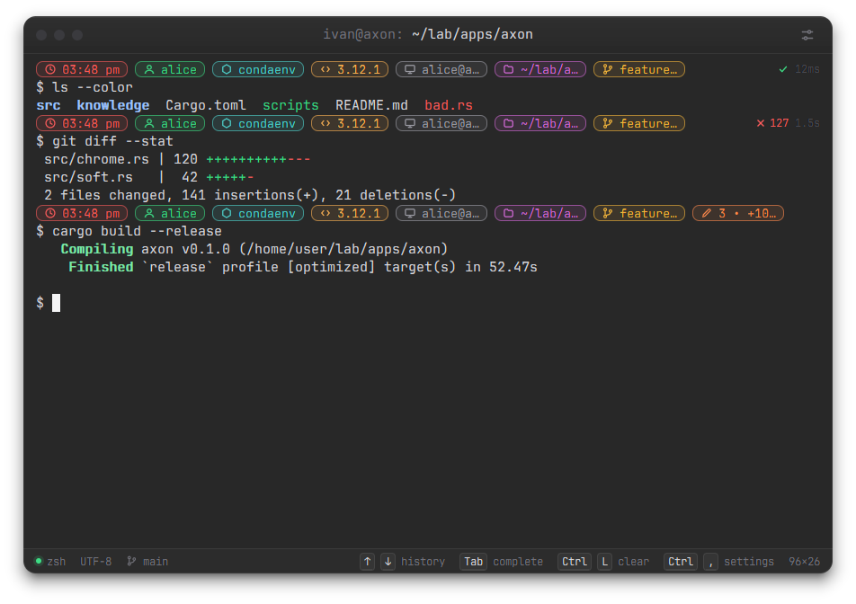

# axon

Native terminal emulator: **simple, minimalist, high-performance and futuristic**.
Written in Rust, for Wayland (own client, CPU-rendered into `wl_shm`, no GPU stack) with a `winit` + `wgpu` fallback for X11 until it gets its own client (see `knowledge/decisions/0011-software-render-wl-shm.md`).


<sub>A frame from the real renderer (`scripts/design.sh`), with alpha: what you see behind it is this page.</sub>

- **Own Wayland client and CPU renderer**: the grid is painted straight into a shared-memory buffer, only the damaged rows. ~14 MB idle, no Vulkan or GL loaded.
- **Zero idle usage**: no continuous redraw; it only paints when there are events (the one timer is the time chip's clock, once a minute, and only while that chip is shown).
- **Full VT emulation** thanks to [`alacritty_terminal`](https://crates.io/crates/alacritty_terminal).
- **Dark glass look** (after the `terminal.html` reference, ADR 0021): one rounded translucent pane with a soft shadow; a title bar and a status bar divided from the grid by hairlines, grey window buttons that turn red/yellow/green on hover, one amber accent and six clear hues (also the ANSI colours), outline chip icons and a settings screen with a live preview. The frame is computed per pixel (`src/chrome.rs`), no images. On the default backend; the `winit` fallback only has the black-and-white colours.
- **Prompt chips** (opt-in): a row of context chips on the line above your prompt (time, user, directory, git branch and changes, conda/venv, pyenv, Kubernetes), chosen and ordered by you. See [Prompt chips](#prompt-chips).
- **Design board**: `design/board.html` shows frames from the real renderer over different desktops, zoomed to the pixel and compared with a baseline (see [Design](#design)).
- **Small binary** (7.3 MiB, see [Benchmarks](#benchmarks)) with LTO, `panic=abort` and `strip`.

## Requirements

- Recent stable Rust (`cargo`, 2024 edition).
- Linux. On Wayland: `libxkbcommon.so.0` (loaded at run time for keyboard layouts; every desktop with Wayland has it). On X11, or without that library, axon falls back to `winit` + `wgpu`, which needs a Vulkan/GL driver.
- A monospaced font. By default it looks for, in this order: `~/.local/share/fonts/JetBrainsMono[wght].ttf`,
  `CascadiaMonoNF.ttf`, `CascadiaMono.ttf` and DejaVu Sans Mono. JetBrains Mono has no Nerd/Powerline icons: set
  `AXON_FONT` to a Nerd Font if your prompt uses them.

## Installation

```sh
scripts/install.sh                       # build and install for your user under ~/.local
scripts/install.sh --prefix /usr/local   # system-wide (run as root with --no-build after building as yourself)
scripts/install.sh --uninstall           # remove it again
```

It installs the binary (`bin/axon`), a desktop entry (so axon appears in your launcher) and the icon
(`assets/axon.svg`) under the prefix, and warns if the prefix is not in your `PATH` or no monospaced font is found.
`--no-build` reuses `target/release/axon`; `DESTDIR` is honoured for packaging.

## Usage

```sh
cargo run --release      # run
cargo build --release    # binary at target/release/axon
```

Always use `--release`: debug mode is much slower.

### Shortcuts

| Shortcut | Action |
|---|---|
| `Ctrl+,` | Open or close the settings screen (also the sliders icon in the title bar) |
| `Alt+N` / `Alt+W` | New window (a shell of its own) / close the window |
| `Alt+1…9`, `Alt+[` / `Alt+]` | Go to window *n* / the previous / the next one |
| `Alt+B` | Show or hide the panel of windows (`[windows] tabs = "left" \| "right" \| "top"`, `side`, `side_width`); the button right of the window buttons does the same |
| `Ctrl+Shift+C` / `Ctrl+Shift+V` | Copy / paste |
| `Ctrl+Shift+Q` | Quit |
| `Ctrl` + `+` / `-` / `0` | Increase / decrease / reset font size |
| `Shift+PageUp/PageDown/Home/End` | Navigate the scrollback |
| `Ctrl+Shift+R` | Reload `config.toml` (fonts, spacing, opacity, blur, prompt chips) |
| Mouse wheel | Scroll (sends arrow keys on the alternate screen; wheel reports when the program asks for the mouse) |
| Mouse in vim, tmux, htop, less | Clicks, drags, motion and wheel go to the program; hold `Shift` to select text anyway (`wl` backend) |
| Click, double click, triple click | Selection: simple, word, line |
| Drag the title bar, double click it | Move the window, maximize / restore |
| Title bar buttons (left): close, minimize, maximize | Window controls (grey; they turn red, yellow and green under the pointer) |
| Drag from an edge or corner, or just outside it | Resize the window |
| `Alt` + drag | Move the window (`winit` fallback only, it has no title bar) |

### Settings screen

Click the **sliders icon** at the right end of the title bar, or press **`Ctrl+,`**. A glass panel opens over the grid with two
tabs. **Font**: the font (a picker over the installed monospaced fonts), size, weight, bold text, letter spacing, line
height, window opacity, compositor blur and the interface **language** (auto, English or Español). **Input**: the input type (shell prompt or prompt chips), the clock format, the cursor shape
(block, bar or underline) and a switch per chip (see [Prompt chips](#prompt-chips)). A live **preview** at the top shows the chips and a
prompt line in the font, weight and spacing you are editing, and "Unsaved changes" appears when the draft differs from the file. `PageUp` / `PageDown` or `Ctrl+Tab` change tab. Everything changes the real window as you drag, so you judge the text by eye. **Save** writes
`~/.config/axon/config.toml` (your comments stay, only what you changed is written); **Cancel**, `Esc`, the gear or
`Ctrl+,` again put everything back. Keys: arrows and `Tab` move between rows, left and right change a value (`Shift`:
five steps; on the chip grid they move the cursor), `Space` flips the switch or the chip, `Enter` saves.

**Typing a number:** click the number at the right of a slider (or select its row and just start typing). It becomes a
box: type digits, a `.` or `,` for decimals and a leading `-`; `Enter`, `Tab`, or a click elsewhere keeps it, `Esc`
drops it. A typed number is not limited to the slider's span, only to the file's limits (size 6 to 96, weight 100
to 900, spacing -8 to 32, line height 0.8 to 3, opacity 0.3 to 1); weights snap to tens.


### Prompt chips

`[input] mode = "chips"` (or **Input type → Prompt chips** in the settings screen) draws a row of rounded chips on the
line right above the prompt you are typing at, in the style of Warp's prompt chips. They sit exactly where you type, move
with the prompt, and disappear while a program runs. The shell still edits the line: axon does not replace your prompt,
it adds context above it. **The chips replace your prompt's own text** (`user@host:~/dir`) with a bare `$`, since they say it already; your `PS1` is kept and comes back when you switch to *Shell prompt*, and the window title is still set. Chips are drawn at **90 % of the font size** set in the settings (a 14 px font gives 12.6 px chips: text, icon, padding and height all follow), with outline icons, from the same font file, rasterized on the fly through one reused buffer, so they keep no tiles or caches.



| Chip | Shows | Comes from |
|---|---|---|
| `time` | `03:48 pm` (or `15:48`, `clock = "24h"`) | the clock; the only wake-up while idle, once a minute |
| `user`, `host` | `alice`, `alice@machine` | `$USER`, `/proc/sys/kernel/hostname` |
| `dir` | `~/Desktop` (the last three parts if longer) | `/proc/<shell>/cwd`: right with no help from the shell |
| `branch` | `main`, or a short hash when detached | `.git/HEAD`, worktrees and submodules included |
| `changes` | `3 • +10 -2`: files, lines added, lines removed | `git diff HEAD --numstat`, run by the shell's hook at each prompt (with the repository's own hooks and filters off, under `timeout 0.5`), so it needs the hook (`axon shell-init`; bash gets it from axon) |
| `pyenv` | `3.12.1` | `$PYENV_VERSION`, else the nearest `.python-version`, else `~/.pyenv/version` |
| `kube` | `prod-eu` | `current-context` of `$KUBECONFIG` or `~/.kube/config` |
| `env` | the conda environment or virtualenv | the shell's own variables, through the hook below |

A chip with nothing to say is skipped. **Order:** in the settings screen (Input tab) drag a chip to a new slot to reorder it, drag it into the greyed area to switch it off (and back to switch it on), or focus it and press `Alt+Left` / `Alt+Right`; a click still toggles it. The order is the `chips = [...]` list, so it is saved with the file and survives page changes and context updates. The list decides which appear and in what order; chips that
do not fit the window width are shortened with `…` and then dropped from the end. They are re-read when the terminal
prints (at most twice a second), never on the UI thread.

**How axon finds your prompt.** axon cannot see where the shell draws its prompt, so the shell marks it: while the chips
are on, the prompt starts with a line of its own holding one concealed space (whose colour is the prompt's number) and
ends with another where you type. axon finds those marks, so the chips stay on the line of every prompt, in the
scrollback too, with what they said when you typed there. The marks are invisible, count as one column and copy as
spaces. **axon starts bash with the
hook already in `PROMPT_COMMAND`**, so it works with nothing to configure and switches on and off at the next prompt
without a restart. For zsh, fish, or a bash whose rc file replaces `PROMPT_COMMAND`, add one line to the rc file:

```sh
eval "$(axon shell-init bash)"          # ~/.bashrc;  zsh: ~/.zshrc;  fish: axon shell-init fish | source
```

**How long each command took.** At the right end of a prompt's chips, once its command has finished, axon shows a green check
or a red cross with the exit status (when it is not 0) and the time: `12ms`, `1.4s`, `2m 5s`. The hook tells axon when a
command starts and when the next prompt appears, through window-title escapes that axon swallows (they never reach your
title bar), and axon times them as it reads them. The last 256 prompts are remembered; older rows keep an empty line.
The hook also tells axon your conda/venv, `PYENV_VERSION` and `KUBECONFIG` (only the shell knows them). A prompt
framework that rewrites `PS1` on every prompt (starship, oh-my-posh) may need the hook after it. The chips are on the `wl`
backend only. The settings screen has live preview.

### Language

The window's text (settings screen, status bar hints, the preview) is available in **English and Spanish**. `[ui] language`
is `auto` (the default: Spanish when `LC_ALL`, `LC_MESSAGES` or `LANG` starts with `es`, English otherwise), `en` or `es`;
the last row of the settings screen's Font page changes it live. The config file, the command line and the shell hooks stay
in English. Strings live in `src/i18n.rs` (ADR 0022).

### Configuration file

The settings screen writes the file for you; it can also be edited by hand. axon reads `~/.config/axon/config.toml`
(or `$XDG_CONFIG_HOME/axon/config.toml`) if it exists; every setting is optional. **Create it from the terminal with `axon config`**: it writes the file with every setting, commented, and never
overwrites an existing one.

| Command | Does |
|---|---|
| `axon config` | Creates the file if it is missing and prints where it is |
| `axon config edit` | The same, then opens it in `$VISUAL` or `$EDITOR` |
| `axon config show` | Prints the settings in effect (file plus environment) and the mistakes in the file |
| `axon config path` | Prints the path |
| `axon shell-init bash\|zsh\|fish` | Prints what to add to the shell's rc file so the prompt chips work in it |
| `axon --help`, `axon --version` | Usage, version |
 [`assets/config.example`](assets/config.example) lists them all, commented, and `scripts/install.sh` puts a
copy in `share/doc/axon/`. **`Ctrl+Shift+R` applies the file to the running window.** A mistake is printed to stderr
with its line number and skipped; a number out of range is clamped.

```toml
[font]
family = "JetBrains Mono"   # a family name, or the path of a .ttf / .otf
size = 15                   # pixels, 6 to 96
weight = 400                # 100 thin ... 900 black (synthesized for now)
bold = true                 # bold text at weight + 300; false draws it regular
letter_spacing = 0          # extra pixels between letters, -8 to 32
line_height = 1.0           # multiple of the font's own height, 0.8 to 3
smoothing = "rgb"           # "rgb" or "bgr" (LCD sub-pixels, match your panel) or "gray"
hinting = true              # snap flat tops, x-height and baseline to whole pixel rows

[window]
opacity = 0.88              # 0.3 to 1
blur = false                # ask the compositor to blur behind the glass (KDE, ext-background-effect; not GNOME)
status_bar = true           # the 28 px bar at the bottom: shell, encoding, branch, key hints, grid size

[ui]
language = "auto"           # "auto" (your locale), "en" or "es": the language of the window's text

[input]
mode = "shell"              # "shell" leaves the prompt as it is; "chips" puts the chips above it
clock = "12h"               # "12h" (03:48 pm) or "24h"
cursor = "block"            # "block", "bar" or "underline" until a program asks for another (it does not blink)
chips = ["time", "user", "env", "pyenv", "host", "dir", "branch", "changes", "kube"]   # shown left to right
```

The file is a small subset of TOML read by our own parser (`src/config.rs`): sections, `key = value`, `#` comments,
strings, numbers and booleans. The Weight is synthesized because the font reader (`fontdue`) cannot read the variable
axis of a font like `JetBrainsMono[wght].ttf`; the own font reader (task 12) will use the real axis.

### Environment variables (win over the file)

| Variable | Default | Description |
|---|---|---|
| `AXON_FONT` | — | Path to a monospaced `.ttf`/`.otf` font |
| `AXON_FONT_SIZE` | `15` | Font size in logical pixels |
| `AXON_OPACITY` | `0.93` (`winit`), `0.88` (`wl`) | Opacity of the glass body (if the compositor supports transparency) |
| `AXON_DECORATIONS` | off | `1` to use the system title bar (`winit` fallback only) |
| `AXON_BACKEND` | `wl` on Wayland, else `winit` | `wl`: own Wayland client + CPU renderer (~14 MB idle). `winit`: `winit` + `wgpu` (~150 MB idle), also the automatic fallback if `wl` cannot start |

## Design

The look is designed on real frames, not mockups. `src/design.rs` renders the window through the actual
renderer in a fixed set of scenes (states, palette, opacity variants) and writes PNGs with alpha plus the design
tokens; [`design/board.html`](design/board.html) puts them over several desktops (light, dark, a page of text,
stripes, checker), zooms to device pixels (1×, 2×, 4×) and compares against a baseline, side by side or split.

```sh
scripts/design.sh --baseline   # keep the current frames as the baseline
# ... change chrome.rs, palette.rs, soft.rs ...
scripts/design.sh              # render the new frames, then open design/board.html
```

The frames are build output (`design/frames/`, `design/baseline/`, git-ignored). `assets/screenshot.png` is a copy of
`design/frames/rest.png`.

## Benchmarks

Measured with [`scripts/bench.sh`](scripts/bench.sh) (`--clean` adds a cold build). Release profile: fat LTO,
`codegen-units = 1`, `panic = abort`, `strip`. Window 1000x640, idle shell. **Updated on every change that
can move size or speed** (rule in `CLAUDE.md`); older numbers stay in the history table.

Machine: AMD Ryzen 5 5600H (12 threads) + RTX 3050 Mobile, Ubuntu, kernel 7.0.0-44, GNOME Shell 50.1 on Wayland.
Last measured: 2026-11-24, on top of `02c3490` plus mouse reporting, the config file with the `axon config` command, the settings screen, the lost-frame watchdog, the prompt chips and the blur request, the sub-pixel text rasterizer with vertical hinting, the proportional settings font, fades, draggable chips and the UI refactor after `terminal.html` (the cold build time is from `02c3490`).

**Build**

| Binary | Cold release build |
|---|---|
| 7.4 MiB (7,733,936 bytes) | 96 s |

**Idle memory and CPU** (`AXON_BACKEND` selects the backend; `wl` is the own Wayland client with the CPU renderer and the
default on Wayland, `winit` is the `winit` + `wgpu` fallback)

| Backend | Font | RSS | PSS | Private (anon) | CPU |
|---|---|---|---|---|---|
| `wl` | JetBrains Mono (default) | **15 MB** | 10 MB | 6 MB | 0 ticks / 3 s |
| `wl` | DejaVu Sans Mono | 20 MB | 15 MB | 11 MB | 0 ticks / 3 s |
| `wl` | Cascadia Mono NF | 58 MB | 53 MB | 49 MB | 0 ticks / 3 s |
| `winit` | JetBrains Mono (default) | 149 MB | 56 MB | 32 MB | 0 ticks / 3 s |
| `winit` | DejaVu Sans Mono | 155 MB | 60 MB | 37 MB | 0 ticks / 3 s |
| `winit` | Cascadia Mono NF | 192 MB | 96 MB | 74 MB | 0 ticks / 3 s |

The idle target is under 50 MB of RSS. `wl` meets it with the default font; a Nerd Font such as Cascadia Mono NF costs
~45 MB inside `fontdue` (it parses every glyph), which the own font reader will remove. The `winit` backend cannot meet
the target: the Vulkan loader and the drivers map ~94 MB.

**Throughput** (`cat` of 99.6 MB of text lines)

| Backend | Time | RSS afterwards |
|---|---|---|
| `wl` | 1.64 s* | 37 MB |
| `winit` | 1.28 s* | 179 MB |

\* Quiet machine, before the title bar work. The title bar build measured 1.95-2.08 s (`wl`) and 1.57-1.61 s (`winit`) while a browser held the load average at 3-4: `winit`, which runs none of this code, slowed down as much, so it is the machine. Re-measure on an idle machine.

Not measured yet: startup time, input latency, and a comparison with Alacritty, Ghostty and foot (not installed here).

**History** (binary size and idle RSS with the default font; newest first)

| Date | Change | Binary | Idle RSS `winit` | Idle RSS `wl` |
|---|---|---|---|---|
| 2026-11-24 | Title bar after the reference: panel button, name and place as the title, windows as tabs at the top (`tabs = "top"`) | 7,733,936 B | 149 MB | 15 MB |
| 2026-11-24 | Windows and the side panel (`Win` per shell, `side.rs`, `[windows]`, `Alt+N/W/1-9/[/]/B`, ADR 0023); one window idle 15 MB, three windows ~18 MB | 7,730,960 B | 150 MB | 15 MB |
| 2026-11-24 | The changes chip comes from the shell's hook (`git diff` with the repository's hooks and filters off, `timeout 0.5`), axon no longer runs git: `safe.directory` works, the 3 s timer and the git thread are gone | 7,694,984 B | 150 MB | 15 MB |
| 2026-11-24 | Interface in English and Spanish (`i18n.rs`, `[ui] language`, a Language row in the settings) | 7,694,728 B | 150 MB | 15 MB |
| 2026-11-24 | Per-command status (`history.rs`): the hook's title escapes timed on the PTY thread, a ring of 256 prompt records, chips kept on every prompt with a check or cross and the duration | 7,694,728 B | 148 MB | 15 MB |
| 2026-11-24 | UI after `terminal.html` (ADR 0021): new palette, hairlines, coloured window buttons, status bar, outline chip icons from the reference, settings with live preview, sliding tabs and cursor shape | 7,694,728 B | 145 MB | 14 MB |
| 2026-11-24 | Text quality: 6x supersampled glyphs with vertical hinting and LCD sub-pixel coverage (`font.rs`, `soft.rs`), settings in a proportional font with fades, draggable chip order; the settings screen open costs ~22 MB RSS | 7,617,368 B | 148 MB | 14 MB |
| 2026-11-24 | Prompt chips at 80 % of the font size (later 90 %, outline icons) (`Fonts::small`, `Soft::paint_text`): text rasterized on the fly, icons scaled | 7,585,040 B | 149 MB | 14 MB |
| 2026-11-24 | Window blur (`[window] blur`, settings switch): `ext-background-effect-v1` and KDE blur protocols in `wl.rs`; GNOME 50 offers neither | 7,586,856 B | 149 MB | 14 MB |
| 2026-11-24 | Prompt chips (`bar.rs`, `context.rs`, `paint.rs`): context chips on the line above the prompt, Input tab in the settings screen, `axon shell-init`; idle with the chips on 14.9 MB, flood 1.74 s with them | 7,583,032 B | 149 MB | 15 MB |
| 2026-11-24 | Watchdog: a redraw stuck on a lost frame callback or buffer release goes on after 250 ms (suspend and resume froze the window) | 7,498,904 B | 146 MB | 15 MB |
| 2026-11-23 | Settings screen: numbers can be typed into boxes | 7,499,608 B | 149 MB | 14 MB |
| 2026-11-23 | Settings screen (`settings.rs`, gear, sfnt reader, `config::save`); +5 MB RSS while it is open | 7,483,864 B | 150 MB | 14 MB |
| 2026-11-23 | Config file (`config.rs`): font family, size, weight, letter spacing, line height, opacity; `axon config` creates it, `Ctrl+Shift+R` reloads | 7,409,792 B | 150 MB | 14 MB |
| 2026-11-23 | Mouse reporting (`mouse.rs`: modes 1000/1002/1003, SGR, UTF-8, classic) | 7,370,048 B | 149 MB | 14 MB |
| 2026-11-23 | Continuous glass (no title pane, sheen or rim gradient), background-coloured cells are glass | 7,366,560 B | 149 MB | 13 MB |
| 2026-11-23 | Own window shadow (margin, window geometry, input region), opacity 0.88, design board | 7,366,064 B | 149 MB | 14 MB |
| 2026-11-23 | Sharper text (plain source-over, coverage contrast) and pixel-aligned buttons | 7,362,960 B | 155 MB | 14 MB |
| 2026-11-23 | Stage C: keyboard (`xkb.rs`), clipboard, wheel, selection; `wl` is the default backend | 7,363,488 B | 150 MB | 14 MB |
| 2026-11-23 | JetBrains Mono becomes the default font | 7,332,888 B | 149 MB | 13 MB |
| 2026-11-22 | `b30bc13`: glass chrome (`chrome.rs`), pointer input, black-and-white palette (Cascadia NF default) | 7,332,888 B | 196 MB | 55 MB |
| 2026-11-22 | `8db3cc9`: own Wayland client, `view.rs`, `session.rs` | 7,325,272 B | 191 MB | 54 MB |
| 2026-11-22 | `0b72197`: CPU renderer `soft.rs`, `cell.rs`, `font.rs` (not wired in) | 7,197,832 B | 191 MB | n/a |
| 2026-11-22 | `eae69b5`: initial commit (damage tracking, cell buffer, lazy fonts) | 7,197,400 B | 191 MB | n/a |
| 2026-11-22 | Before the lazy-font fix (never committed) | n/a | 946 MB | n/a |

## Architecture

```
src/
├─ main.rs      picks the backend; the `winit` + `wgpu` fallback app
├─ cell.rs      Cell format, flags, tile contract shared by the renderers
├─ font.rs      fonts, glyph table, special tiles (shared by the renderers)
├─ gpu.rs       wgpu, atlas, pipelines
├─ soft.rs      CPU renderer into an ARGB framebuffer
├─ chrome.rs    window frame: glass look, rounded corners, title bar, buttons, shadow, hit testing
├─ palette.rs   the colour tokens (amber accent, six hues) and ANSI resolution
├─ paint.rs     antialiased shapes composited into the framebuffer (settings screen, prompt chips)
├─ bar.rs       the prompt chips: layout, icons, painting over the reserved prompt line (grid's own font)
├─ i18n.rs      the interface's strings in English and Spanish (`tr`), the language setting
├─ history.rs   each prompt's chips as they were, and how long its command ran (the hook's title escapes)
├─ context.rs   what the chips say: directory, git, Python, Kubernetes, time (read on a thread)
├─ settings.rs  the settings screen (Font and Input tabs)
├─ config.rs    the settings file: parser, writer, `axon config`, `axon shell-init`
├─ view.rs      grid → cells for any renderer (damage, cursor, selection)
├─ session.rs   Term + PTY thread
├─ wl.rs        own Wayland client: wire protocol, window, shm buffers
├─ wlapp.rs     the default app on wl.rs + soft.rs: keyboard, pointer, clipboard, one poll loop
├─ xkb.rs       keyboard layouts through libxkbcommon (dlopen)
├─ input.rs     Keys → xterm sequences (pure)
├─ mouse.rs     mouse reports for programs (xterm 1000/1002/1003, SGR, UTF-8, classic; pure)
├─ palette.rs   Black-and-white palette and ANSI color resolution
├─ design.rs    (tests) design board frames, own PNG encoder, incremental-repaint check
└─ shader.wgsl  Cell and background shaders
design/board.html   the design board (frames from scripts/design.sh)
```

Flow: `wl_keyboard → xkb → input → PTY → Term (alacritty) → coalesced Wakeup → View::build → soft → wl_shm buffer`.

The architecture, dependency rules, performance budgets and modularization roadmap are documented
as Claude Code skills in [`.claude/skills/`](.claude/skills):

| Skill | Contents |
|---|---|
| `axon-architecture` | Layers, data flow, dependency rules, crate plan |
| `axon-performance` | Budgets (CPU, latency, RAM) and how to measure them |
| `axon-renderer` | Atlas, cell buffer format, shader, wgpu 30 notes |
| `axon-extend` | Recipes: shortcuts, config, themes, mouse, new platforms |
| `axon-design-language` | Visual identity and what to avoid |

Plan, decisions (ADRs), risks and measurements live in the knowledge tree at
[`knowledge/`](knowledge/INDEX.md). Summary in [`CLAUDE.md`](CLAUDE.md).

## Status and known limitations

- Mouse reports reach applications on the `wl` backend only; the `winit` fallback keeps local selection.
- Text is drawn with sub-pixel (LCD) coverage and vertical hinting by our own rasterizer (ADR 0020), tuned for an RGB panel; set `smoothing = "gray"` for a rotated or OLED-triangle screen. Fallback fonts (CJK, symbols) are grey and unhinted. The settings screen uses a proportional UI font (+7 MB RSS while open).
- Synthesized bold; no italics or ligatures; no color emoji.
- Blur: a request to the compositor, not our own effect; GNOME (Mutter) offers none, so there it does nothing. Settings: fonts, opacity, blur and the prompt chips (settings screen or `config.toml`); colours, shortcuts and themes are not configurable yet. The weight is synthesized.
- Input: the chips sit above the prompt, but the line is still edited by the shell. An own input editor (Warp's "Input type") is the next step, not built yet. The chip colours are fixed; the chips are `wl` only, and zsh and fish need the `axon shell-init` line (and keep their own prompt text).
- Tested only on Linux/Wayland.

## License

To be decided.
